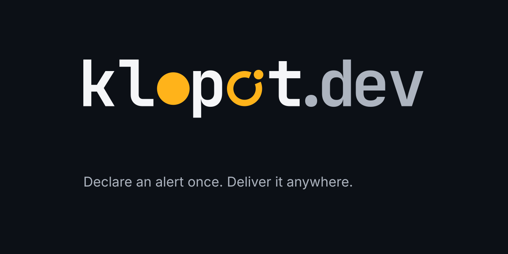
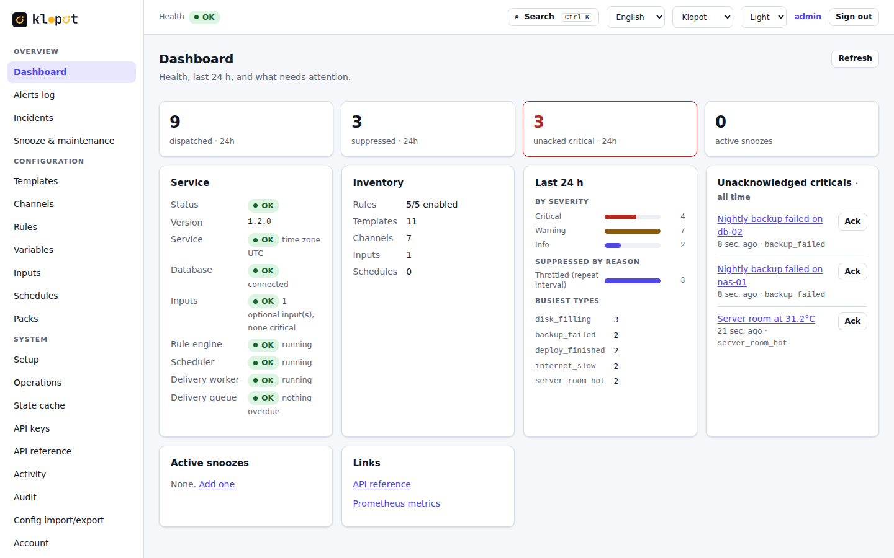
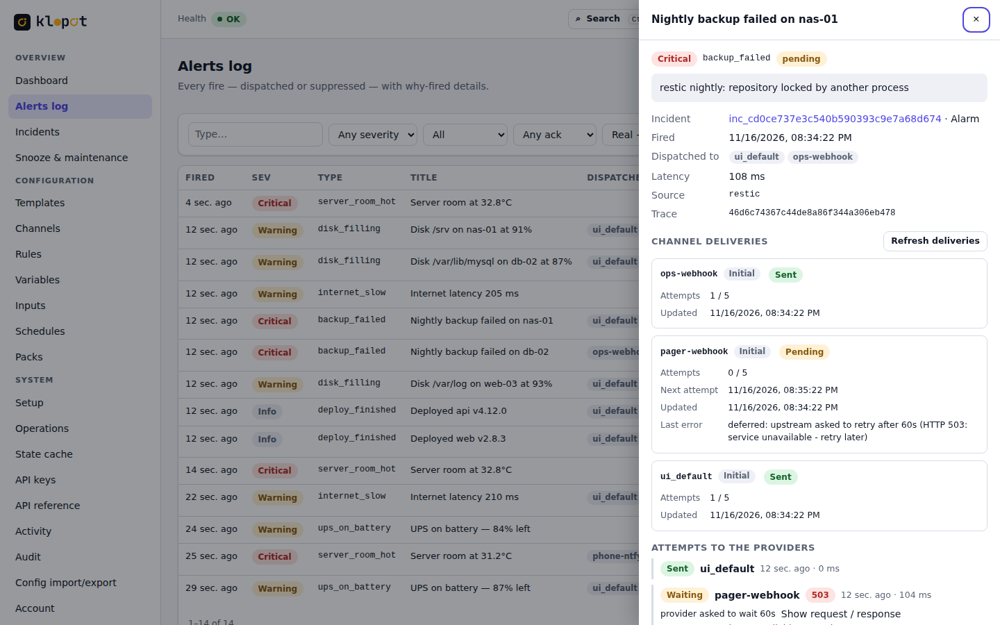
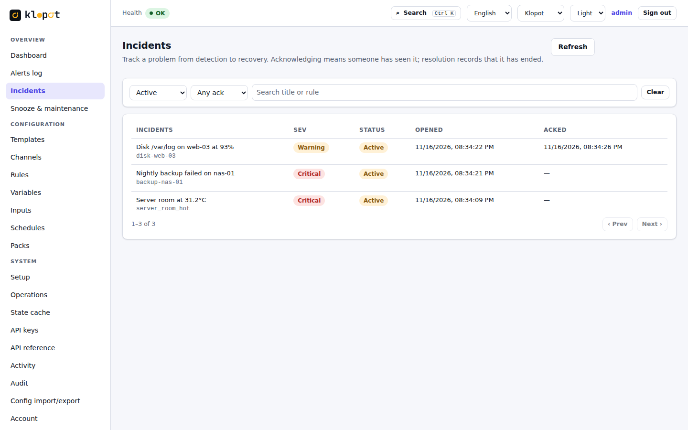
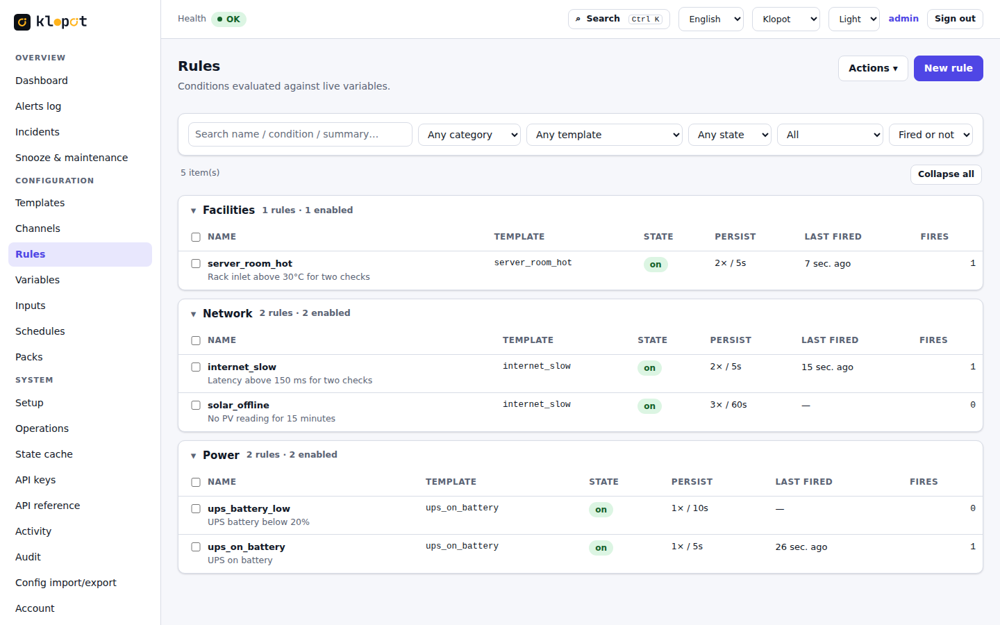
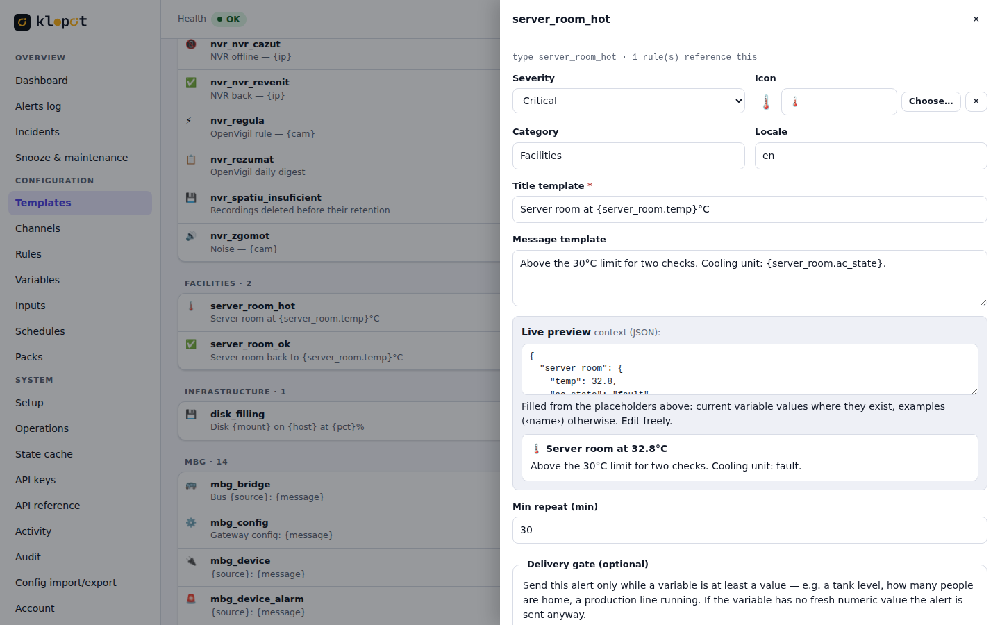
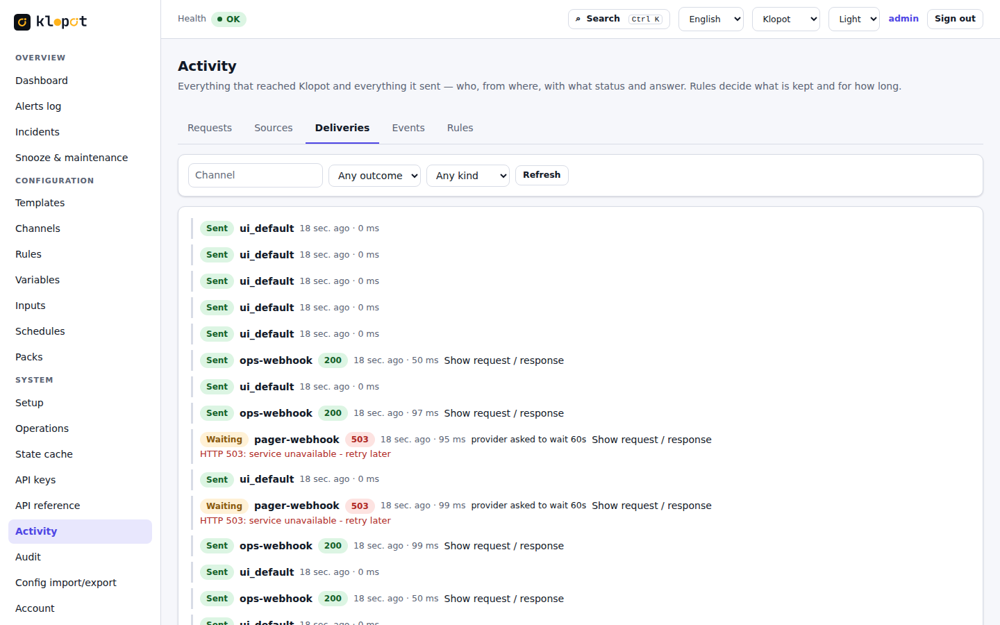
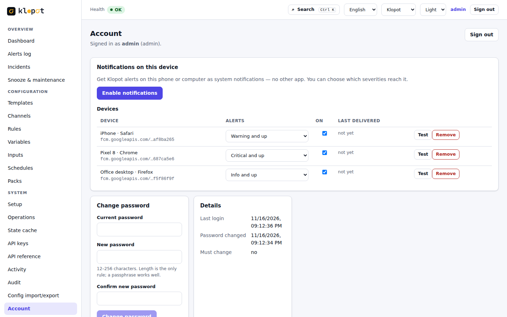

<p align="center">
  
</p>

<h1 align="center">Klopot</h1>

<p align="center">
  <b>Declare an alert once. Deliver it anywhere.</b><br>
  A self-hosted, API-driven notification microservice — you declare inputs,
  rules, templates and channels; it evaluates and delivers, with throttling,
  retries and a full audit trail.
</p>

<p align="center">
  <a href="https://github.com/sm26449/klopot/actions/workflows/ci.yml?query=branch%3Amain"></a>
  <a href="https://github.com/sm26449/klopot/releases/latest"></a>
  <a href="https://github.com/sm26449/klopot/pkgs/container/klopot"></a>
  <a href="LICENSE"></a>
  
  <a href="https://klopot.dev"></a>
  <a href="https://scorecard.dev/viewer/?uri=github.com/sm26449/klopot"></a>
</p>

<p align="center">
  <a href="LICENSE">Apache-2.0</a> ·
  Python 3.12 · FastAPI · MySQL 8 ·
  <a href="README.ro.md">Română</a>
</p>

<p align="center">
  <picture>
    <source media="(prefers-color-scheme: dark)" srcset="docs/screenshots/dashboard-dark.png">
    
  </picture>
</p>

> **Naming.** The product is **Klopot**; the daemon, its image entry point and
> its `ALERTD_*` settings are still called `alertd` through 1.x. Klopot was
> born as the alerting service of a home-energy monitoring stack, but nothing
> in it is domain-specific.

**Release status.** 1.1.1 (2026-11-15) is the current release — a hardening
release on top of 1.1.0 (no default passwords, read its upgrade notes). 1.1.0,
on top of the
1.0.x durable escalation, rule incidents, Telegram actions, MQTT output and
operational monitoring it adds Alertmanager/Grafana ingestion, native ntfy /
Gotify / Pushover, SMS providers, packs, a setup guide, the activity log, Web
Push to an installable admin UI and generated client SDKs. Read the
[upgrade notes](CHANGELOG.md#upgrade-notes) before upgrading an existing
install; [project status](docs/PROJECT_STATUS.md) summarises the release.

---

Fire an alert from anything that can make an HTTP request — a script, a cron
job, Node-RED, another service. The caller needs only an API key and an alert
*type*; Klopot owns routing, channels and secrets:

```bash
curl -X POST https://your-host/v1/fire \
  -H "X-API-Key: $KLOPOT_API_KEY" \
  -H "Content-Type: application/json" \
  -d '{"type": "backup_failed", "context": {"job": "nightly-db", "error": "timeout"}}'
```

```json
{ "id": "ntf_1794139677372_7fc1…", "dispatched": true,
  "channels": ["ui_default", "telegram_oncall"], "status": "sent",
  "title": "Backup failed: nightly-db", "severity": "warning" }
```

## Works with

Delivery channels — add one by configuration, no code:

**UI (live WebSocket)** · **Telegram** · **SMS** (via a gateway) · **Email** ·
**Web Push** (the admin UI installs as an app, iPhone included) · **MQTT** · **ntfy** · **Gotify** · **Pushover** (incl. emergency until acknowledged) ·
**Slack / Discord / Home Assistant** (generic webhook)

Telegram supports opt-in acknowledgement and snooze buttons through a dedicated
bot. See the [setup and action semantics](docs/TELEGRAM.md) (Romanian).

[MQTT output](docs/MQTT_OUTPUT.md) publishes JSON with stable replay identities.
[Operational monitoring](docs/OPERATIONS.md) includes an admin page, Prometheus
metrics, a Grafana dashboard and example alert rules.

Native ntfy, Gotify and Pushover, the SMS providers (`http`, `twilio`,
`teltonika`) and Web Push devices ([details](docs/WEB_PUSH.md)) arrived in 1.1.0.

Client libraries (install from `sdk/`): Python `klopot-client` and
TypeScript `@klopot/client` — `await klopot.fire("disk_full", { host: "nas" })`.
See [sdk/README.md](sdk/README.md).

Inputs — where values come from: **MQTT** · **HTTP poll** · **inbound webhook**
· **inbound SMS** · **cron schedules** · **Alertmanager / Grafana**.

## Try it in two minutes

A self-contained demo (Klopot + MySQL + Mosquitto + a sine-wave sensor + a
webhook sink) that fires a real alert end to end:

```bash
git clone https://github.com/sm26449/klopot.git
cd klopot
export ALERTD_BOOTSTRAP_ADMIN_KEY="alertd_$(python3 -c 'import secrets; print(secrets.token_urlsafe(32))')"
docker compose -f compose.demo.yml up -d --build
./demo/smoke.sh          # asserts a notification reaches the sink within 2 min
docker compose -f compose.demo.yml down -v
```

## Run it for real

Production uses **MySQL 8 only**. SQLite is an in-memory test harness, with a
separate real-MySQL test gate; it is not a runtime fallback. See
[testing](CONTRIBUTING.md#tests).

```bash
cp .env.example .env        # DB passwords, MQTT broker, admin password, channel secrets
docker compose up -d        # Klopot + MySQL + nightly backups, port 127.0.0.1:5090
open http://localhost:5090/admin/     # admin UI
open http://localhost:5090/docs       # OpenAPI / Swagger (open on plain-HTTP localhost)
```

Compose variants that ship with the repo:

| Variant | Command |
|---------|---------|
| Production, no proxy | `docker compose up -d` |
| Production behind traefik (TLS), private to your LAN/VPN | `docker compose -f docker-compose.yml -f compose.traefik.yml up -d` |
| … plus `POST /v1/fire` open to the internet, with limits | `docker compose -f docker-compose.yml -f compose.traefik.yml -f compose.public.yml up -d` |
| Development (builds locally, bundled MQTT broker) | `docker compose -f docker-compose.yml -f compose.dev.yml up --build` |

Migrations run on startup. [Deploy](docs/DEPLOY.md) covers the traefik setup
(docker or file provider), backups and upgrades. Then follow
[Getting Started](docs/GETTING_STARTED.md), or install a ready-made pack from
**Admin UI → Packs** (service heartbeat, sensor threshold, Alertmanager —
see [Packs](docs/PACKS.md)).

## Screenshots

<table>
  <tr>
    <td width="50%"><a href="docs/screenshots/log-delivery.png"></a><br><sub>Every alert with its delivery per channel — sent, deferred by the provider, retried</sub></td>
    <td width="50%"><a href="docs/screenshots/incidents.png"></a><br><sub>Incidents: detection to recovery, acknowledgement separate from resolution</sub></td>
  </tr>
  <tr>
    <td width="50%"><a href="docs/screenshots/rules.png"></a><br><sub>Rules grouped by category, with their last firing</sub></td>
    <td width="50%"><a href="docs/screenshots/template-editor.png"></a><br><sub>Template editor with a live preview from current values</sub></td>
  </tr>
  <tr>
    <td width="50%"><a href="docs/screenshots/activity.png"></a><br><sub>Activity: every attempt to a provider, with its HTTP answer</sub></td>
    <td width="50%"><a href="docs/screenshots/push-devices.png"></a><br><sub>Web Push to the installed app — per device, per severity</sub></td>
  </tr>
</table>

<sub>Synthetic demo data; regenerate with <code>scripts/screenshots.sh</code>. The admin UI also works on a phone and installs as an app.</sub>

## Features

- **API-first.** Every input, variable, rule, template, channel, route and
  schedule is a DB row, editable over REST. Live OpenAPI at `/docs`.
- **Rules.** A whitelisted expression language (no raw `eval`), N-of-N
  persistence, per-rule eval interval, Alertmanager-style inhibition.
- **Incidents (opt-in).** Track rule problems through acknowledgement and
  recovery, with hysteresis and optional recovery notices. [Details](docs/INCIDENTS.md).
- **Gating.** Enable flags, snooze (type / rule / channel), quiet hours,
  min-repeat throttling, duplicate coalescing.
- **Durable delivery (at-least-once).** A fire is persisted with a per-channel
  delivery row **before** any external send; a background worker retries
  failures with backoff and reconciles after a restart.
- **Observability.** An Operations page for queues, workers and connections;
  Prometheus `/v1/metrics`, portable Grafana dashboard and alert rules;
  structured logs, request trace ids and configuration audit.
- **Activity log.** Every request received, every attempt to a provider with
  its HTTP exchange, and state changes of inputs, rules and channels, with
  editable keep / ignore rules. [Details](docs/ACTIVITY_LOG.md).
- **Packs and import / export.** Install ready-made configuration with
  parameters, export any selection as a pack, and import item by item with a
  preview. [Details](docs/PACKS.md).
- **Admin UI** at `/admin` — a dependency-light, build-less SPA to manage it
  all, watch the live log, and test channels: a setup guide for a new
  installation, global search (Ctrl+K / ⌘K), English and Romanian, light /
  dark and OS-native themes, phone layout, installable as an app for Web Push
  (keyboard-accessible, AA contrast).

## How it works, in one paragraph

Klopot subscribes to the declared inputs and keeps a live **state cache** of
variable values. Every few seconds it evaluates each enabled **rule** against
that cache; a rule that matches for its required consecutive ticks builds an
envelope for the **dispatcher**. The dispatcher applies gating, then persists a
`notifications_log` row **and** a `deliveries` row per routed channel in one
transaction *before* sending. It makes a synchronous first attempt; any channel
that fails retryably stays **pending** and a background **delivery worker**
retries it with backoff. Channel adapters enforce their own rate limits and
circuit breakers, and every config change is audited.

## Documentation

| Doc | What it covers |
|-----|----------------|
| **[Getting Started](docs/GETTING_STARTED.md)** · [RO](docs/GETTING_STARTED.ro.md) | Core concepts + an end-to-end walkthrough |
| **[API Reference](docs/API.md)** · [RO](docs/API.ro.md) | Every REST + WebSocket endpoint, auth, errors |
| [Deploy & Operations](docs/DEPLOY.md) | Install, env vars, backups, upgrades, rollback |
| [Project status](docs/PROJECT_STATUS.md) | Released baseline, later work, verified deployment and next steps |
| [Operational monitoring](docs/OPERATIONS.md) | Queue visibility, metrics, Grafana and Prometheus setup |
| [MQTT output](docs/MQTT_OUTPUT.md) · [Telegram actions](docs/TELEGRAM.md) | Setup, replay identities, acknowledgement and snooze |
| [Architecture](docs/ARCHITECTURE.md) | Components, data flow, the transactional outbox |
| [Expression language](docs/EXPRESSION_LANGUAGE.md) | Rule condition syntax + built-in functions |
| [Packs](docs/PACKS.md) | Install, write and export packs (config with parameters) |
| [Activity log](docs/ACTIVITY_LOG.md) · [Web Push](docs/WEB_PUSH.md) | What is recorded and kept; notifications on a device without an app |
| [All docs →](docs/README.md) | The full index |

## License & contributing

Licensed under the **Apache License 2.0** — see [LICENSE](LICENSE) and
[NOTICE](NOTICE). Bundled frontend runtime (vendored, build-less):
[Preact](https://preactjs.com) (MIT) · [htm](https://github.com/developit/htm)
(Apache-2.0).

See [CONTRIBUTING.md](CONTRIBUTING.md) for dev setup and conventions,
[SECURITY.md](SECURITY.md) for reporting vulnerabilities, and
[CHANGELOG.md](CHANGELOG.md) for history.

Website: **[klopot.dev](https://klopot.dev)**. Bugs and ideas go to
[Issues](https://github.com/sm26449/klopot/issues); anything else —
questions, help with an installation, an integration — to
**contact@klopot.dev** or the form on the site.

---

## The team

Built by **[Stefan Maldaianu](https://github.com/sm26449)** — product owner,
operator and the person who gets paged at 02:00 — together with
**[Claude](https://claude.ai)** (Anthropic), pair-programmer across
architecture, code, audits, documentation and the Klopot brand.

Human judgement, machine stamina. The best team in the stack.
