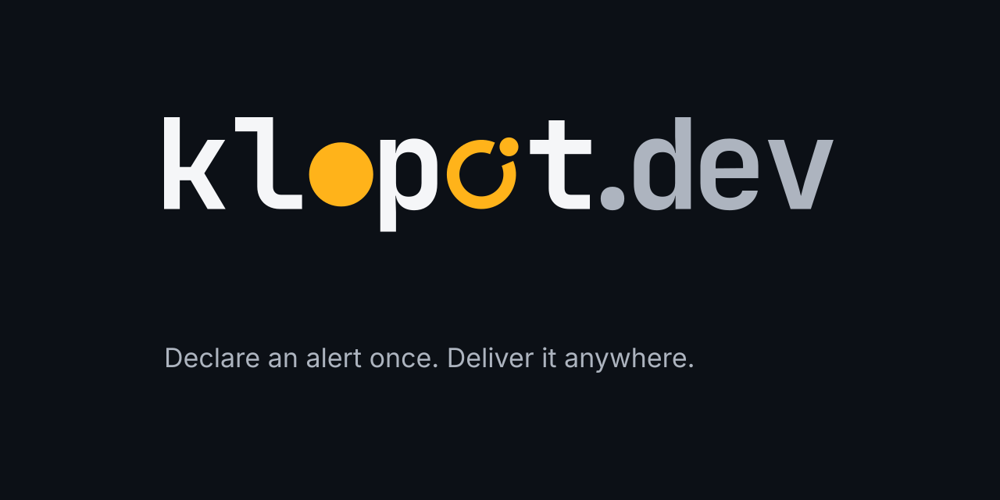
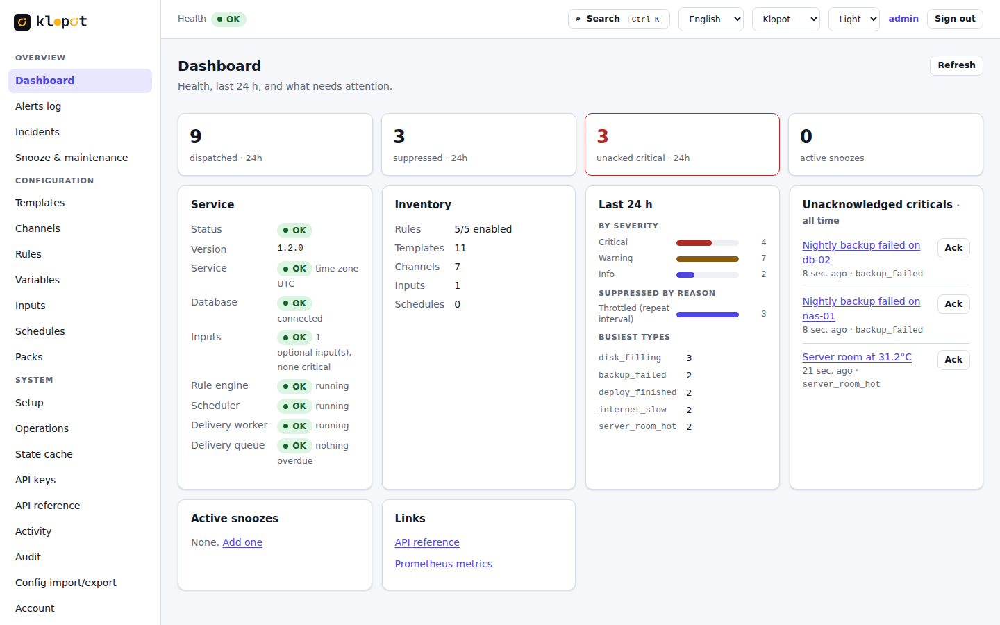
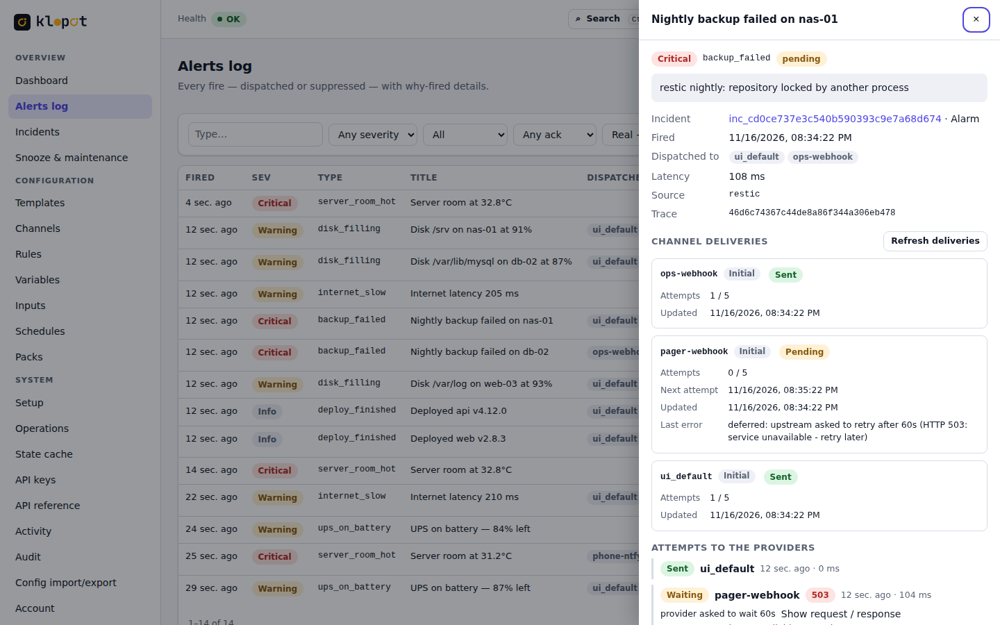
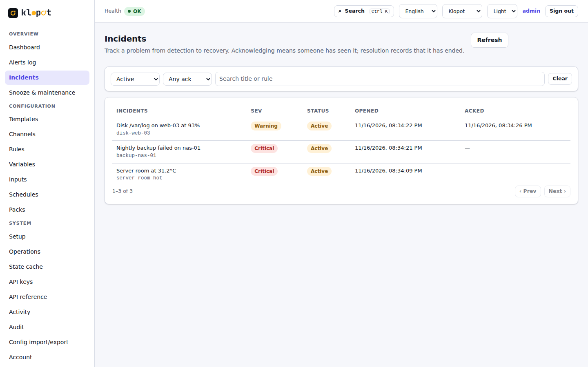
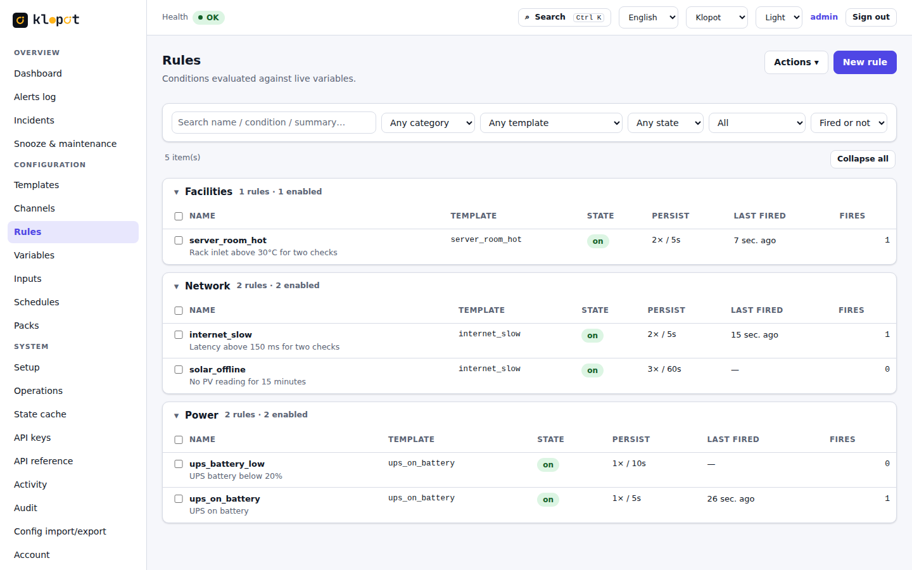
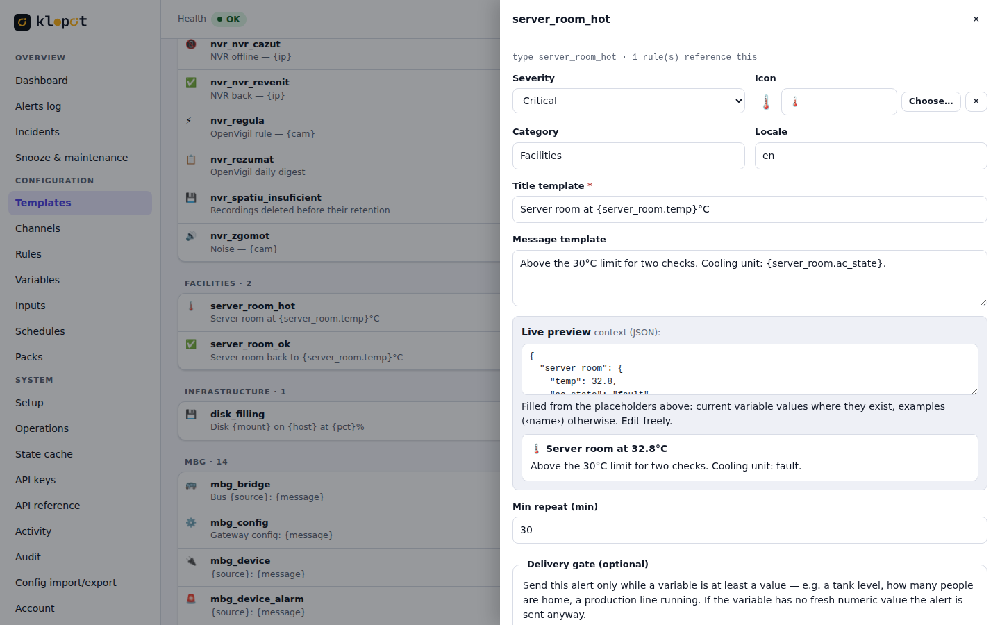
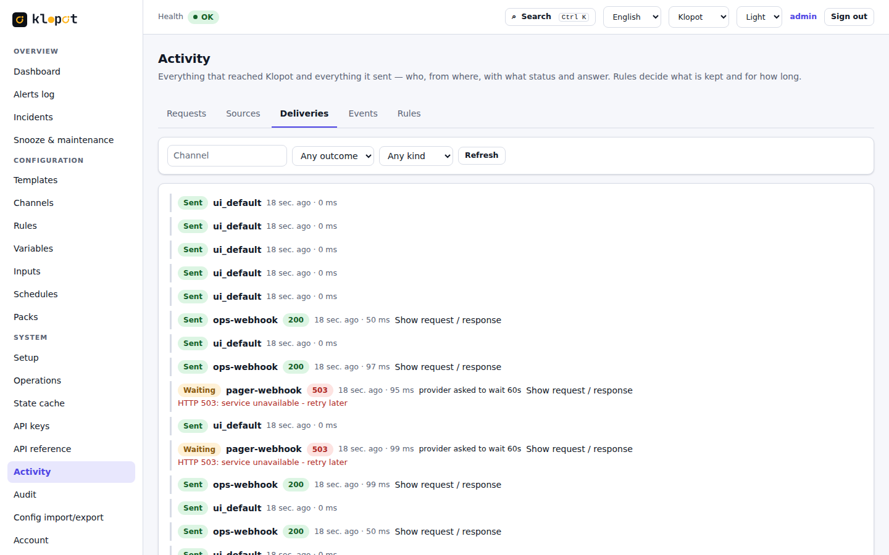
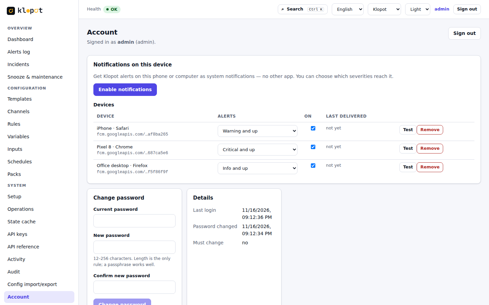

<p align="center">
  
</p>

<h1 align="center">Klopot</h1>

<p align="center">
  <b>Declari o alertă o singură dată. O livrezi oriunde.</b><br>
  Un microserviciu de notificări self-hosted, condus prin API — declari intrări,
  reguli, șabloane și canale; el evaluează și livrează, cu throttling, reîncercări
  și un audit complet.
</p>

<p align="center">
  <a href="https://github.com/sm26449/klopot/actions/workflows/ci.yml?query=branch%3Amain"></a>
  <a href="https://github.com/sm26449/klopot/releases/latest"></a>
  <a href="https://github.com/sm26449/klopot/pkgs/container/klopot"></a>
  <a href="LICENSE"></a>
  
  <a href="https://klopot.dev"></a>
  <a href="https://scorecard.dev/viewer/?uri=github.com/sm26449/klopot"></a>
</p>

<p align="center">
  <a href="LICENSE">Apache-2.0</a> ·
  Python 3.12 · FastAPI · MySQL 8 ·
  <a href="README.md">English</a>
</p>

<p align="center">
  <picture>
    <source media="(prefers-color-scheme: dark)" srcset="docs/screenshots/dashboard-dark.png">
    
  </picture>
</p>

> **Denumire.** Produsul este **Klopot**; daemonul, punctul de intrare din
> imagine și setările `ALERTD_*` se numesc încă `alertd` pe toată linia 1.x.
> Klopot s-a născut ca serviciul de alertare al unui sistem de monitorizare a
> energiei de acasă, dar nimic din el nu este specific unui domeniu.

**Starea versiunii.** 1.2.0 (2026-11-16) este versiunea curentă — pregătită
pentru internet: proxy privat implicit, limite pe fiecare cale de intrare și
restricții de adresă și de ritm pe cheie și pe intrare; câteva valori implicite
sunt mai stricte, deci citește notele de actualizare. 1.1.1 a eliminat parolele
implicite. 1.1.0, peste escaladările durabile, incidentele de regulă, acțiunile Telegram, ieșirea MQTT
și monitorizarea operațională din 1.0.x aduce receiver-ul Alertmanager/Grafana,
ntfy / Gotify / Pushover native, furnizorii SMS, pachetele, ghidul de
configurare, jurnalul de activitate, Web Push către interfața admin instalată ca
aplicație și SDK-urile client generate. Citește
[notele de upgrade](CHANGELOG.md#upgrade-notes) înainte de a actualiza o
instalare existentă; [starea proiectului](docs/PROJECT_STATUS.md) rezumă
versiunea.

---

Declanșează o alertă din orice poate face un request HTTP — un script, un cron,
Node-RED, alt serviciu. Apelantul are nevoie doar de o cheie API și de un *tip*
de alertă; Klopot deține rutarea, canalele și secretele:

```bash
curl -X POST https://host-ul-tau/v1/fire \
  -H "X-API-Key: $KLOPOT_API_KEY" \
  -H "Content-Type: application/json" \
  -d '{"type": "backup_failed", "context": {"job": "nightly-db", "error": "timeout"}}'
```

```json
{ "id": "ntf_1794139677372_7fc1…", "dispatched": true,
  "channels": ["ui_default", "telegram_oncall"], "status": "sent",
  "title": "Backup failed: nightly-db", "severity": "warning" }
```

## Funcționează cu

Canale de livrare — adaugi unul prin configurare, fără cod:

**UI (WebSocket live)** · **Telegram** · **SMS** (prin gateway) · **Email** ·
**Web Push** (interfața admin se instalează ca aplicație, inclusiv pe iPhone) · **MQTT** · **ntfy** · **Gotify** · **Pushover** (inclusiv urgență până la confirmare) ·
**Slack / Discord / Home Assistant** (webhook generic)

Telegram permite confirmarea și amânarea alertelor prin butoane, cu un bot
dedicat. Vezi [configurarea și comportamentul acțiunilor](docs/TELEGRAM.md).

[Ieșirea MQTT](docs/MQTT_OUTPUT.md) publică JSON cu ID stabil pentru reîncercări.
[Monitorizarea operațională](docs/OPERATIONS.md) include pagina din Klopot,
metrici Prometheus, un dashboard Grafana și reguli de alertare.

ntfy, Gotify și Pushover native, furnizorii SMS (`http`, `twilio`,
`teltonika`) și dispozitivele Web Push ([detalii](docs/WEB_PUSH.md)) au apărut
în 1.1.0.

Biblioteci client (se instalează din `sdk/`): Python
`klopot-client` și TypeScript `@klopot/client` —
`await klopot.fire("disk_full", { host: "nas" })`. Vezi
[sdk/README.md](sdk/README.md).

Intrări — de unde vin valorile: **MQTT** · **HTTP poll** · **webhook de intrare**
· **SMS de intrare** · **programări cron** · **Alertmanager / Grafana**.

## Încearcă în două minute

Un demo complet (Klopot + MySQL + Mosquitto + un senzor sinus + un sink webhook)
care declanșează o alertă reală cap-coadă:

```bash
git clone https://github.com/sm26449/klopot.git
cd klopot
export ALERTD_BOOTSTRAP_ADMIN_KEY="alertd_$(python3 -c 'import secrets; print(secrets.token_urlsafe(32))')"
docker compose -f compose.demo.yml up -d --build
./demo/smoke.sh          # verifică o notificare la sink în sub 2 min
docker compose -f compose.demo.yml down -v
```

## Rulează-l în producție

În producție folosim **doar MySQL 8**. SQLite este folosit în memorie pentru
testele rapide, separat de testele pe MySQL real; nu este un fallback în runtime.
Vezi [testarea](CONTRIBUTING.md#tests).

**Cerințe:** Docker cu Compose v2 (`docker compose`), MySQL 8 (containerul
inclus sau serverul tău) și o gazdă x86-64 — imaginea publicată este doar
`linux/amd64` (pe alte platforme o construiești din surse). Klopot folosește
de obicei ~150 MB de RAM; vezi [limitele de resurse](docs/DEPLOY.md#resource-limits).

```bash
cp .env.example .env        # parole DB, broker MQTT, parolă admin, secrete canale
docker compose up -d        # Klopot + MySQL + backup zilnic, port 127.0.0.1:5090
open http://localhost:5090/admin/     # interfața admin
open http://localhost:5090/docs       # OpenAPI / Swagger (deschis pe localhost HTTP)
```

Variantele de compose incluse în repository:

| Variantă | Comandă |
|----------|---------|
| Producție, fără proxy | `docker compose up -d` |
| Producție în spatele traefik (TLS), privat pentru LAN/VPN | `docker compose -f docker-compose.yml -f compose.traefik.yml up -d` |
| … plus `POST /v1/fire` deschis spre internet, cu limite | `docker compose -f docker-compose.yml -f compose.traefik.yml -f compose.public.yml up -d` |
| Dezvoltare (build local, broker MQTT inclus) | `docker compose -f docker-compose.yml -f compose.dev.yml up --build` |

Migrările rulează la pornire. [Deploy](docs/DEPLOY.md) descrie configurarea
traefik (provider docker sau file), backup-urile și upgrade-urile. Apoi urmează
[Getting Started](docs/GETTING_STARTED.ro.md), sau instalează un pachet gata
făcut din **Admin UI → Pachete** (heartbeat serviciu, prag senzor, Alertmanager
— vezi [Pachete](docs/PACKS.md)).

## Capturi de ecran

<table>
  <tr>
    <td width="50%"><a href="docs/screenshots/log-delivery.png"></a><br><sub>Fiecare alertă cu livrarea pe fiecare canal — trimisă, amânată de furnizor, reîncercată</sub></td>
    <td width="50%"><a href="docs/screenshots/incidents.png"></a><br><sub>Incidente: de la detectare la revenire, confirmarea separată de rezolvare</sub></td>
  </tr>
  <tr>
    <td width="50%"><a href="docs/screenshots/rules.png"></a><br><sub>Reguli grupate pe categorii, cu ultima declanșare</sub></td>
    <td width="50%"><a href="docs/screenshots/template-editor.png"></a><br><sub>Editorul de șabloane, cu previzualizare din valorile curente</sub></td>
  </tr>
  <tr>
    <td width="50%"><a href="docs/screenshots/activity.png"></a><br><sub>Activitate: fiecare încercare către un furnizor, cu răspunsul HTTP</sub></td>
    <td width="50%"><a href="docs/screenshots/push-devices.png"></a><br><sub>Web Push în aplicația instalată — pe dispozitiv, pe severitate</sub></td>
  </tr>
</table>

<sub>Date demo sintetice; se regenerează cu <code>scripts/screenshots.sh</code>. Interfața funcționează și pe telefon și se instalează ca aplicație.</sub>

## Funcționalități

- **API-first.** Fiecare intrare, variabilă, regulă, șablon, canal, rută și
  programare este un rând în DB, editabil prin REST. OpenAPI live la `/docs`.
- **Reguli.** Un limbaj de expresii whitelisted (fără `eval` brut), persistență
  N-din-N, interval de evaluare per regulă, inhibiție în stil Alertmanager.
- **Incidente (opțional).** Urmărești problemele până la confirmare și revenire,
  cu histerezis și notificări de rezolvare configurabile. [Detalii](docs/API.ro.md#incidente).
- **Gating.** Flag-uri de activare, snooze (tip / regulă / canal), ore de
  liniște, throttling min-repeat, coalescență de duplicate.
- **Livrare durabilă (at-least-once).** O alertă e persistată cu un rând de
  livrare per canal **înainte** de orice trimitere externă; un worker de fundal
  reîncearcă eșecurile cu backoff și reconciliază după restart.
- **Observabilitate.** Pagina Monitorizare pentru cozi, workere și conexiuni;
  Prometheus `/v1/metrics`, dashboard Grafana și reguli de alertare;
  loguri structurate, trace-id per request și audit al configurării.
- **Jurnal de activitate.** Fiecare request primit, fiecare încercare către un
  furnizor cu schimbul HTTP și schimbările de stare ale intrărilor, regulilor și
  canalelor, cu reguli editabile de păstrare / ignorare. [Detalii](docs/ACTIVITY_LOG.md).
- **Pachete și import / export.** Instalezi configurație gata făcută, cu
  parametri, exporți orice selecție ca pachet și imporți element cu element,
  cu previzualizare. [Detalii](docs/PACKS.md).
- **Interfață admin** la `/admin` — un SPA fără build, cu care gestionezi tot,
  urmărești logul live și testezi canalele: ghid de configurare pentru o
  instalare nouă, căutare globală (Ctrl+K / ⌘K), română și engleză, teme
  luminoasă / întunecată și native sistemului de operare, aspect pentru
  telefon, instalabilă ca aplicație pentru Web Push (accesibilă din tastatură,
  contrast AA).

## Cum funcționează, într-un paragraf

Klopot se abonează la intrările declarate și ține un **cache de stare** live al
valorilor variabilelor. La câteva secunde evaluează fiecare **regulă** activă
față de acel cache; o regulă care se potrivește de câte ori i se cere consecutiv
construiește un envelope pentru **dispatcher**. Dispatcherul aplică gating, apoi
persistă un rând `notifications_log` **și** un rând `deliveries` per canal rutat
într-o singură tranzacție *înainte* de trimitere. Face o primă încercare
sincronă; orice canal care eșuează reîncercabil rămâne **pending** și un
**delivery worker** de fundal îl reîncearcă cu backoff. Adaptoarele de canal au
propriile rate limit-uri și circuit breaker-e, și fiecare schimbare de config e
auditată.

## Documentație

| Doc | Ce acoperă |
|-----|------------|
| **[Getting Started](docs/GETTING_STARTED.ro.md)** | Concepte + un tur cap-coadă |
| **[API Reference](docs/API.ro.md)** | Fiecare endpoint REST + WebSocket, auth, erori |
| [Deploy & Operare](docs/DEPLOY.md) | Instalare, env vars, backup, upgrade, rollback |
| [Starea proiectului](docs/PROJECT_STATUS.md) | Baseline-ul publicat în changelog, lucrări ulterioare, deploy verificat și pașii următori |
| [Monitorizare operațională](docs/OPERATIONS.md) | Cozi, metrici, configurare Grafana și Prometheus |
| [Ieșire MQTT](docs/MQTT_OUTPUT.md) · [Acțiuni Telegram](docs/TELEGRAM.md) | Configurare, deduplicare, confirmare și amânare |
| [Arhitectură](docs/ARCHITECTURE.md) | Componente, flux de date, outbox-ul tranzacțional |
| [Limbaj de expresii](docs/EXPRESSION_LANGUAGE.md) | Sintaxa condițiilor + funcții |
| [Pachete](docs/PACKS.md) | Instalare, scriere și export de pachete (config cu parametri) |
| [Jurnal de activitate](docs/ACTIVITY_LOG.md) · [Web Push](docs/WEB_PUSH.md) | Ce se înregistrează și cât se păstrează; notificări pe un dispozitiv fără aplicație |
| [Toate docs →](docs/README.md) | Indexul complet |

## Licență & contribuții

Licențiat sub **Apache License 2.0** — vezi [LICENSE](LICENSE) și [NOTICE](NOTICE).
Runtime frontend inclus (vendorizat, fără build): [Preact](https://preactjs.com)
(MIT) · [htm](https://github.com/developit/htm) (Apache-2.0).

Vezi [CONTRIBUTING.md](CONTRIBUTING.md) pentru setup și convenții,
[SECURITY.md](SECURITY.md) pentru raportarea vulnerabilităților, și
[CHANGELOG.md](CHANGELOG.md) pentru istoric.

Site: **[klopot.dev](https://klopot.dev/ro/)**. Erorile și ideile merg în
[Issues](https://github.com/sm26449/klopot/issues); orice altceva —
întrebări, ajutor la o instalare, o integrare — la **contact@klopot.dev**
sau prin formularul de pe site.

---

## Echipa

Construit de **[Stefan Maldaianu](https://github.com/sm26449)** — product owner,
operator și omul care primește alerta la 02:00 — împreună cu
**[Claude](https://claude.ai)** (Anthropic), partener de programare pe
arhitectură, cod, audituri, documentație și brandul Klopot.

Judecată umană, rezistență de mașină. Cea mai tare echipă din stack.
